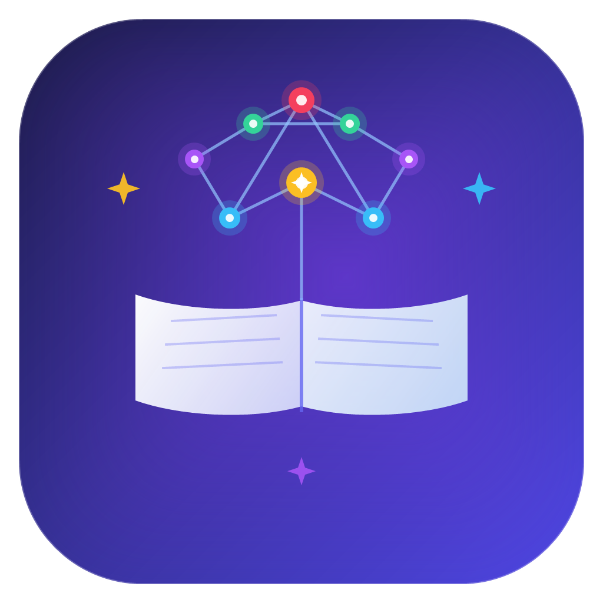
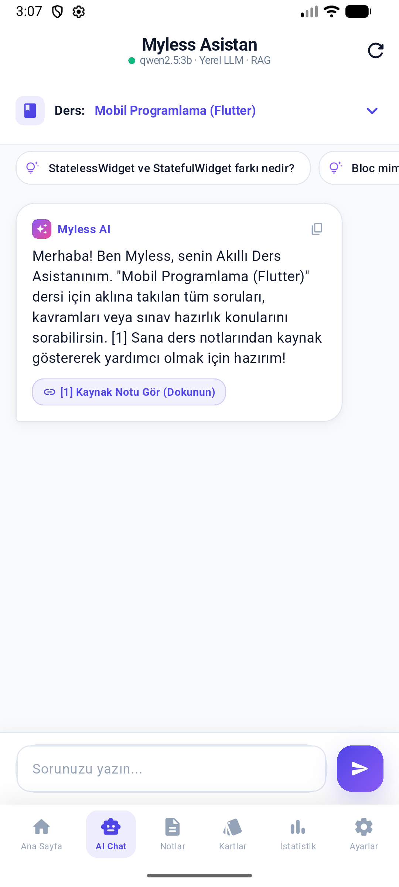
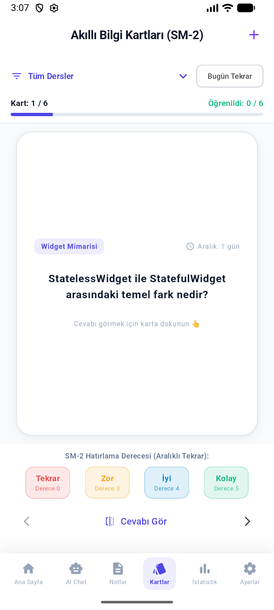
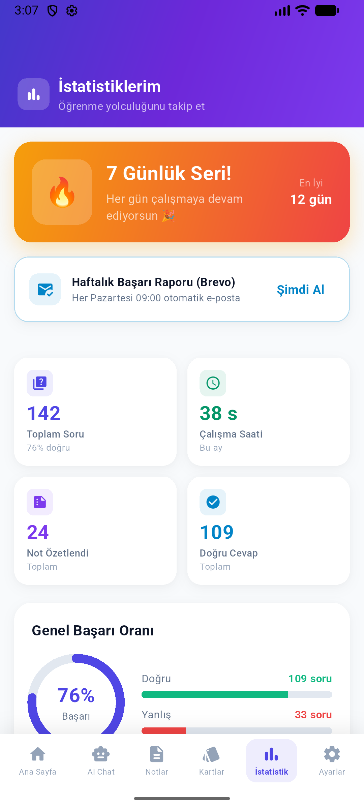
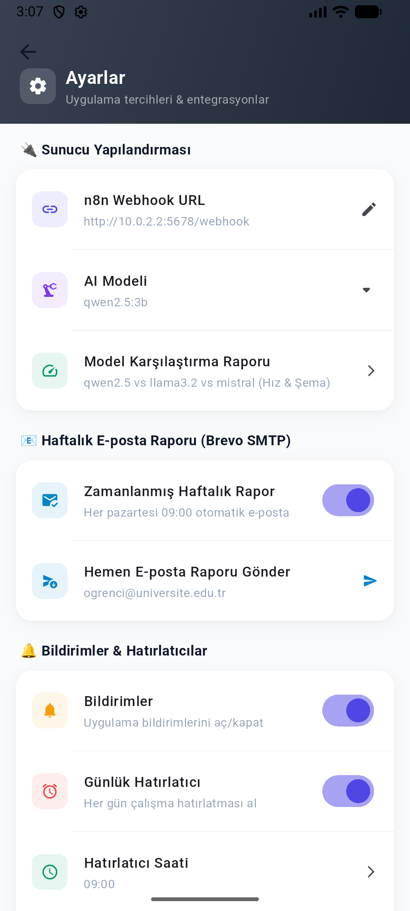

<p align="center">
  
</p>

<h1 align="center">Myless — Akıllı Ders ve Sınav Asistanı</h1>

<p align="center">
  <b>Öğrenciler için yerel çalışan (Local LLM), gizlilik odaklı, yapay zekâ destekli kişisel öğrenme ve sınav hazırlık platformu.</b>
</p>

<p align="center">
  
  
  
  
  
  
  
</p>

---

## 📖 Genel Bakış

**Myless**, öğrencilerin ders çalışma verimini en üst düzeye çıkarmak için tasarlanmış modern bir mobil asistandır. Karışık ders notlarını, PDF belgelerini ve ders tahtası fotoğraflarını saniyeler içinde yapılandırılmış özetlere, pedagojik testlere ve akıllı ezber kartlarına dönüştürür.

Tüm yapay zekâ işlemleri **Ollama** aracılığıyla yerel ortamınızda çalışır; kişisel ders notlarınız ve verileriniz üçüncü taraf bulut servislerine gönderilmez.

---

## 📱 Ekran Görüntüleri Galerisi

<table align="center">
  <tr>
    <td align="center" width="25%">
      <b>Giriş & Güvenlik</b><br/><br/>
      <br/>
      <i>scrypt & JWT korumalı giriş</i>
    </td>
    <td align="center" width="25%">
      <b>Ana Kontrol Paneli</b><br/><br/>
      <br/>
      <i>Pomodoro, sayaç ve günün sorusu</i>
    </td>
    <td align="center" width="25%">
      <b>Myless AI Asistan</b><br/><br/>
      <br/>
      <i>RAG [1] kaynakça rozetleri</i>
    </td>
    <td align="center" width="25%">
      <b>Notlar & OCR</b><br/><br/>
      <br/>
      <i>PDF/TXT & Tahta fotoğrafı analizi</i>
    </td>
  </tr>
  <tr>
    <td align="center" width="25%">
      <b>Ezber Kartları (SM-2)</b><br/><br/>
      <br/>
      <i>3D kart çevirme & aralıklı tekrar</i>
    </td>
    <td align="center" width="25%">
      <b>Öğrenme Analitiği</b><br/><br/>
      <br/>
      <i>Seriler, grafikler ve e-posta raporu</i>
    </td>
    <td align="center" width="25%">
      <b>Ayarlar & Model</b><br/><br/>
      <br/>
      <i>Sunucu URL ve yerel model seçimi</i>
    </td>
    <td align="center" width="25%">
      <b>7 Günlük Çalışma Planı</b><br/><br/>
      <br/>
      <i>Eksik konulara özel AI planlayıcı</i>
    </td>
  </tr>
</table>

---

## ✨ Temel Özellikler

### 💬 Kaynak Gösteren Akıllı Sohbet (RAG Citation)
- Öğrencinin seçtiği derse göre bağlam odaklı soru-cevap.
- Yüklenen ders notları **NoteChunks** parçalarına bölünür ve anlamsal olarak aranır.
- Asistan, cevabın hangi nottan alındığını `[1]` dipnot rozeti ile gösterir; rozete dokunulduğunda kaynak not açılır.

### 📝 Akıllı Not Özetleme & Tahta/Defter OCR
- Metin yapıştırma, `.txt` veya `.pdf` belgesi yükleme desteği.
- **Görsel Model Entegrasyonu:** El yazısı veya tahta fotoğrafları yerel görsel model aracılığıyla otomatik metne çevrilir.
- Anahtar kavramlar, önemli maddeler ve hap bilgiler tek dokunuşla listelenir.

### 🎯 Uyarlanabilir Çoktan Seçmeli Testler & Pratik Modu
- Ders özetinden pedagojik olarak 5 seçenekli veya 4 seçenekli test üretimi (katı JSON şema doğrulamalı).
- **Uyarlanabilir Zorluk:** Öğrencinin son test başarılarına göre otomatik kolay/orta/zor seviye ayarı.
- **Yanlışları Tekrar Çöz:** Sınav sonrasında hatalı yapılan sorular anında açıklamalarıyla interaktif pratik modunda tekrar çözülebilir.
- **Eksik Konu Testi:** Hata yapılan kazanımlara özel yeni odak testleri oluşturma.

### 🗂️ SM-2 Algoritmalı Ezber Kartları (Flashcards)
- Özetlerden tek tuşla soru-cevap ezber kartları oluşturma.
- Akıcı 3D kart çevirme animasyonu.
- **SuperMemo-2 (SM-2) Aralıklı Tekrar:** Zorlanılan kartlar sık, pekiştirilen kartlar daha seyrek sorularak uzun vadeli kalıcı hafıza sağlanır.

### ⏱️ Pomodoro Sayacı & Hedef Takibi
- 25 dakika odaklanma / 5 dakika mola seansları.
- Günlük çözülen soru ve çalışma saati sayaçları ile sınav geri sayım paneli.

### 📅 Kişiselleştirilmiş 7 Günlük Çalışma Programı
- Yapılan testlerdeki zayıf kazanımlar otomatik tespit edilir.
- Gün gün dengeli, hedefe yönelik 7 günlük aksiyon planı üretilir.

### 📊 Öğrenme Analitiği & Haftalık E-Posta Raporu
- Ders bazında başarı grafikleri ve çalışma süreleri.
- Her Pazartesi otomatik veya uygulama içinden tek tuşla tetiklenen **Brevo SMTP** haftalık veli/öğrenci başarı karnesi.

### 🔒 %100 Yerel, Güvenli ve Gizli
- scrypt şifre hashleme ve JWT oturum yönetimi.
- Verileriniz kendi yerel Docker konteynerinizde kalır.

---

## 🏗️ Sistem Mimarisi

```mermaid
flowchart LR
    subgraph Mobile["📱 Myless Flutter Uygulaması"]
        UI["Material 3 Arayüz\n(Chat, Notes, Flashcards, Quiz, Stats)"]
        Client["N8nApiService\n(REST HTTP Client)"]
        UI <--> Client
    end

    subgraph Docker["🐳 Docker Konteyner Ağı (assistant-network)"]
        subgraph n8nEngine["⚙️ n8n Otomasyon Motoru (:5678)"]
            W0["00-error-handler"]
            W1["01-chat (RAG / Context)"]
            W2["02-summarize (NoteChunks)"]
            W3["03-generate-quiz (Adaptive)"]
            W4["04-evaluate-quiz (Recommendations)"]
            W5["10-flashcards (SM-2)"]
            W6["11-extract-image (Vision OCR)"]
            W7["12-weekly-report (Brevo SMTP)"]
        end

        subgraph LocalAI["🧠 Yerel AI Motoru (:11434)"]
            LLM["Ollama: qwen2.5:3b / vision\n(JSON Şema & LLM)"]
        end
    end

    Client <-->|JSON REST Webhook| n8nEngine
    n8nEngine <-->|Local API / HTTP| LocalAI
```



---

## 🚀 Hızlı Kurulum ve Başlangıç

### Ön Koşullar
- [Docker Desktop](https://www.docker.com/products/docker-desktop/) (ve Docker Compose)
- [Flutter SDK](https://docs.flutter.dev/get-started/install) (sürüm 3.x veya üzeri)
- Android Studio / Android Emülatör veya fiziksel bir mobil cihaz

---

### Adım 1: Projeyi İndirin
```bash
git clone https://github.com/Zelox35/MyLess.git
cd MyLess
```

### Adım 2: Arka Ucu İlk Kez Kurun ve Başlatın
Proje ana dizinindeyken aşağıdaki komut, Docker servislerini başlatır; `qwen2.5:3b` modelini ve n8n iş akışlarını hazırlar.

**Windows PowerShell:**
```powershell
.\scripts\setup.bat
```

**Windows Komut İstemi:**
```cmd
scripts\setup.bat
```

**Linux / macOS:**
```bash
chmod +x scripts/setup.sh
./scripts/setup.sh
```

İlk kurulumda model indirme işlemi internet hızınıza bağlı olarak birkaç dakika sürebilir. Kurulum tamamlandığında:
- **n8n Arayüzü:** `http://localhost:5678`
- **Ollama API:** `http://localhost:11434`

### Sonraki Başlatmalar
Bilgisayar yeniden başladıktan sonra arka ucu proje ana dizininden şu komutla başlatın:
```bash
docker compose up -d
```

### Adım 3: Flutter Uygulamasını Çalıştırın

```bash
cd smart_study_assistant
flutter pub get
flutter run
```

`flutter run` bağlı emülatör/cihazı otomatik seçer. Android emülatörünü açıkça seçmek için `flutter devices` ile cihaz kimliğini kontrol edip `flutter run -d <cihaz-kimliği>` kullanın.

> 💡 **Ağ Ayarları İpucu:**
> - **Android Emülatör** kullanıyorsanız varsayılan backend adresi `http://10.0.2.2:5678/webhook` olarak ayarlanmıştır.
> - **Fiziksel Android / iOS Cihaz** kullanıyorsanız, bilgisayarınızın yerel ağ IP'sini (örn: `http://192.168.1.50:5678/webhook`) uygulama içindeki **Ayarlar** ekranından tanımlayabilirsiniz.
> - **Masaüstü (Windows / macOS) / Web** için: `http://localhost:5678/webhook`

### Servisleri Durdurun
Proje ana dizininde:
```bash
docker compose down
```
Bu komut konteynerleri durdurur; indirilmiş model ve n8n verilerini Docker volume'larında korur.

---

## 📁 Proje Dizin Yapısı

```
Myless/
├── .gitignore                      # Git takip dışı dosyalar listesi
├── docker-compose.yml              # n8n ve Ollama konteyner orkestrasyonu
├── .env.example                    # Ortam değişkenleri şablonu
├── README.md                       # Kullanıcı ve geliştirici dokümantasyonu
├── docs/
│   ├── logo.png                    # Uygulama logosu
│   ├── api_contract.md             # REST API JSON veri sözleşmesi
│   └── screenshots/                # Uygulama ekran görüntüleri (8 adet)
│       ├── 01_login_screen.png
│       ├── 02_home_screen.png
│       ├── 03_chat_screen.png
│       ├── 04_notes_screen.png
│       ├── 05_flashcards_screen.png
│       ├── 06_stats_screen.png
│       ├── 07_settings_screen.png
│       └── 08_study_plan_screen.png
├── scripts/
│   ├── setup-model.bat             # Ollama model indirme scripti (Windows)
│   ├── setup-model.sh              # Ollama model indirme scripti (Linux/Mac)
│   ├── test-ollama.bat             # Yerel AI test scripti
│   └── generate_app_icon.ps1       # Mobil launcher simgesi üretici
├── workflows/                      # n8n dışa aktarılmış iş akışları
│   ├── 00_error_handler_workflow.json
│   ├── 1_chat_workflow.json
│   ├── 2_summarize_workflow.json
│   ├── 3_generate_quiz_workflow.json
│   ├── 4_evaluate_quiz_workflow.json
│   ├── 10_flashcards_workflow.json
│   ├── 11_extract_image_workflow.json
│   └── 12_weekly_report_workflow.json
└── smart_study_assistant/          # Flutter istemci kaynak kodları
    ├── pubspec.yaml                # Flutter paket bağımlılıkları
    ├── assets/images/              # Vektörel ve raster görsel kaynaklar
    ├── android/                    # Android yerel konfigürasyon & manifest
    └── lib/
        ├── main.dart               # Uygulama giriş noktası
        ├── core/                   # Material 3 tema ve tasarım sistemi
        ├── models/                 # Veri modelleri (Chat, Note, Quiz, Flashcard, Plan)
        ├── services/               # n8n REST API istemcisi & veri katmanı
        └── screens/                # Sayfa ekranları
            ├── auth/               # Giriş & Kayıt ekranı
            ├── home/               # Ana gösterge paneli (Dashboard)
            ├── chat/               # Soru-Cevap & RAG Sohbet
            ├── notes/              # Not yükleme & özetleme ekranı
            ├── quiz/               # Test çözme, sonuç & pratik ekranları
            ├── flashcards/         # SM-2 3D kart ezber ekranı
            ├── stats/              # Başarı analitiği & rapor ekranı
            └── settings/           # Model ve ağ ayarları ekranı
```

---

## 🛡️ Güvenlik ve Gizlilik

- **Yerel İşleme:** Kişisel ders notları, sınav sonuçları ve sorular asla üçüncü parti sunuculara veya harici AI bulutlarına aktarılmaz.
- **Kimlik Doğrulama:** Şifreler istemci ve sunucu katmanında güvenli scrypt algoritması ile korunur ve JWT ile yetkilendirilir.
- **Ağ İzolasyonu:** Ollama ve n8n servisleri Docker köprü ağı (`assistant-network`) üzerinden güvenle haberleşir.

---

## 📄 Lisans

Bu proje [MIT Lisansı](LICENSE) kapsamında açık kaynak olarak lisanslanmıştır. Detaylar için lisans dosyasına göz atabilirsiniz.
