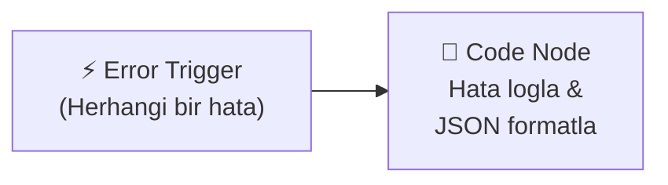
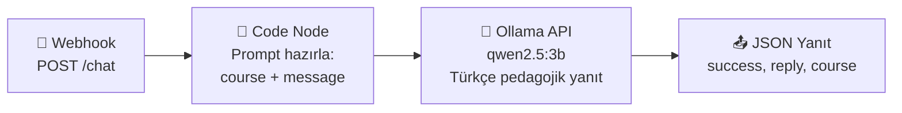
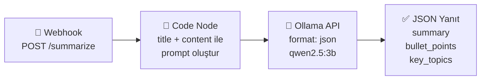
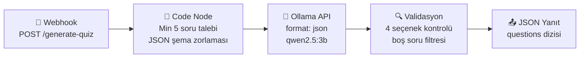
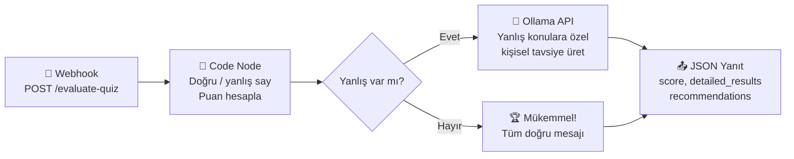
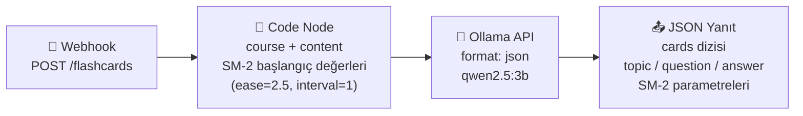
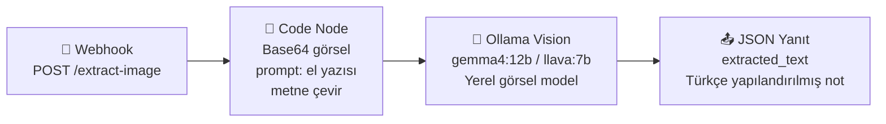
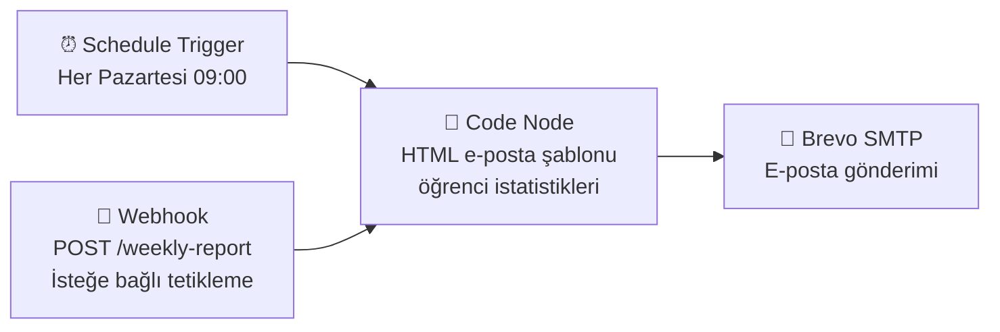

# Myless — n8n Workflow Kurulum Rehberi

Bu belge, Myless uygulamasının arka ucunu oluşturan **8 adet n8n iş akışını** (workflow) nasıl içe aktaracağınızı ve nasıl çalıştığını adım adım açıklar.

---

## Hızlı Kurulum (3 Adım)

### 1. Docker ile n8n'i Başlatın

Proje kök dizininde:

```bash
docker compose up -d
```

Ardından tarayıcınızda açın: **http://localhost:5678**

---

### 2. Workflow'ları İçe Aktarın

1. Sol menüden **Workflows** sekmesine tıklayın.
2. Sağ üstte **+ Add Workflow** > **Import from File** seçin.
3. `workflows/` klasöründeki her JSON dosyasını sırayla içe aktarın.
4. Her workflow'u açıp sağ üstteki **Active** geçişini açın.

---

### 3. Ollama Modelini İndirin

```bash
docker exec -it ollama ollama pull qwen2.5:3b
```

---

## Workflow Listesi ve Açıklamaları

| # | Dosya | Webhook Yolu | Açıklama |
|---|---|---|---|
| 00 | `00_error_handler_workflow.json` | *(Error Trigger)* | Global hata yakalayıcı |
| 01 | `1_chat_workflow.json` | `POST /webhook/chat` | AI Soru-Cevap |
| 02 | `2_summarize_workflow.json` | `POST /webhook/summarize` | Not özetleyici |
| 03 | `3_generate_quiz_workflow.json` | `POST /webhook/generate-quiz` | Test üretici |
| 04 | `4_evaluate_quiz_workflow.json` | `POST /webhook/evaluate-quiz` | Değerlendirme & öneri |
| 10 | `10_flashcards_workflow.json` | `POST /webhook/flashcards` | SM-2 ezber kartı üretici |
| 11 | `11_extract_image_workflow.json` | `POST /webhook/extract-image` | Defter/tahta OCR |
| 12 | `12_weekly_report_workflow.json` | `POST /webhook/weekly-report` | Haftalık e-posta raporu |

---

## Workflow Akış Diyagramları

### 🔵 00 — Global Hata Yakalayıcı



**Açıklama:** Diğer tüm workflow'larda oluşan hatalar bu akış tarafından yakalanır, loglanır ve standart JSON formatında raporlanır.

---

### 💬 01 — AI Soru-Cevap (Chat)

**Webhook:** `POST http://localhost:5678/webhook/chat`



**İstek Örneği:**
```json
{
  "course": "Mobil Programlama",
  "message": "Flutter'da StatefulWidget ne zaman kullanılır?"
}
```

**Yanıt:**
```json
{
  "success": true,
  "reply": "StatefulWidget, kullanıcı etkileşimi veya veri değişimiyle...",
  "course": "Mobil Programlama"
}
```

---

### 📝 02 — Ders Notu Özetleyici (Summarize)

**Webhook:** `POST http://localhost:5678/webhook/summarize`



**İstek Örneği:**
```json
{
  "title": "Flutter Mimarisi",
  "content": "Flutter, Google tarafından geliştirilen açık kaynaklı..."
}
```

**Yanıt:**
```json
{
  "success": true,
  "summary": "Flutter, Dart diliyle çapraz platform uygulama...",
  "bullet_points": ["Widget tabanlı UI", "Hot reload desteği", "Tek kod tabanı"],
  "key_topics": ["Dart", "Widget", "MaterialApp"]
}
```

---

### 🎯 03 — Çoktan Seçmeli Test Üretici (Generate Quiz)

**Webhook:** `POST http://localhost:5678/webhook/generate-quiz`



**İstek Örneği:**
```json
{
  "content": "SOLID prensipleri yazılım tasarımında..."
}
```

**Yanıt:**
```json
{
  "success": true,
  "count": 5,
  "questions": [
    {
      "question": "SOLID'in 'S' harfi neyi temsil eder?",
      "options": ["Single Responsibility", "Secure", "Static", "Simple"],
      "correct_answer": "Single Responsibility",
      "explanation": "Her sınıfın yalnızca tek bir sorumluluğu olmalıdır."
    }
  ]
}
```

---

### 📊 04 — Değerlendirme & Kişisel Öneri (Evaluate Quiz)

**Webhook:** `POST http://localhost:5678/webhook/evaluate-quiz`



**Yanıt:**
```json
{
  "success": true,
  "score": 80,
  "correct_count": 4,
  "wrong_count": 1,
  "detailed_results": [...],
  "recommendations": "SOLID prensiplerinden Open-Closed ilkesini..."
}
```

---

### 🗂️ 10 — SM-2 Ezber Kartı Üretici (Flashcards)

**Webhook:** `POST http://localhost:5678/webhook/flashcards`



**SM-2 Parametreleri (Başlangıç):**
| Alan | Değer | Açıklama |
|---|---|---|
| `repetitions` | `0` | Tekrar sayısı |
| `interval` | `1` | Sonraki tekrar (gün) |
| `ease_factor` | `2.5` | Zorluk çarpanı |

---

### 📸 11 — Defter / Tahta Fotoğrafı OCR (Vision AI)

**Webhook:** `POST http://localhost:5678/webhook/extract-image`



**İstek Örneği:**
```json
{
  "image": "data:image/jpeg;base64,/9j/4AAQSkZJRg..."
}
```

---

### 📧 12 — Haftalık E-posta Raporu (Brevo SMTP)

**İki Tetikleyici:** Otomatik (her Pazartesi 09:00) veya Webhook (isteğe bağlı)



**Webhook İstek Örneği:**
```json
{
  "email": "ogrenci@universite.edu.tr",
  "stats": {
    "totalQuestions": 142,
    "accuracy": 88,
    "studyHours": 38,
    "streak": 7
  }
}
```

---

## Tüm Webhook Referans Tablosu

| Endpoint | Metod | Flutter Servisi | Açıklama |
|---|---|---|---|
| `/webhook/chat` | POST | `ApiService.chat()` | Derse özel soru-cevap |
| `/webhook/summarize` | POST | `ApiService.summarizeNote()` | Not özetleme & RAG |
| `/webhook/generate-quiz` | POST | `ApiService.generateQuiz()` | Test üretimi |
| `/webhook/evaluate-quiz` | POST | `ApiService.evaluateQuiz()` | Puanlama & öneri |
| `/webhook/flashcards` | POST | `ApiService.generateFlashcards()` | SM-2 kart üretimi |
| `/webhook/extract-image` | POST | `ApiService.extractFromImage()` | Görsel → metin |
| `/webhook/weekly-report` | POST | `ApiService.sendWeeklyReport()` | E-posta raporu |

> **Not:** Android emülatöründe `localhost` yerine `10.0.2.2` kullanın.  
> Fiziksel cihazda bilgisayarınızın yerel ağ IP'sini kullanın (örn: `192.168.1.50`).

---

## Sorun Giderme

**n8n'e bağlanamıyorum:**
```bash
docker ps            # konteynerler çalışıyor mu?
docker logs n8n      # n8n hata logları
docker logs ollama   # Ollama hata logları
```

**Ollama modeli yok:**
```bash
docker exec -it ollama ollama list    # yüklü modeller
docker exec -it ollama ollama pull qwen2.5:3b
```

**Webhook çalışmıyor:**
- n8n arayüzünde ilgili workflow'un **Active** olduğunu kontrol edin.
- Flutter uygulamasındaki **Ayarlar** ekranında sunucu URL'sinin doğru olduğunu doğrulayın.
